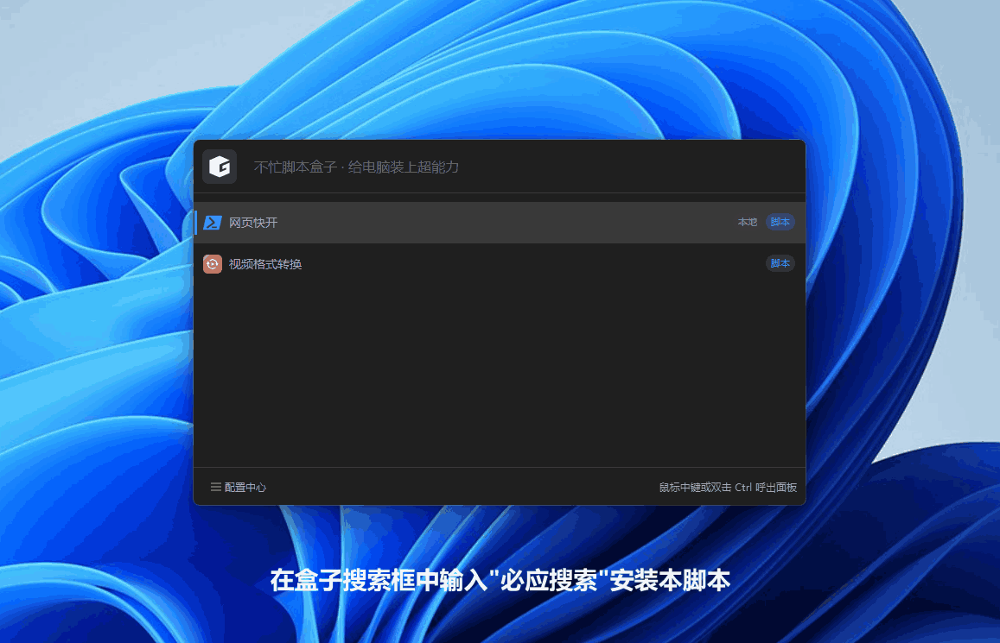

# 必应搜索

> 选中文字连按两次 `Ctrl+C`，或在盒子搜索框输入关键词，自动唤起默认浏览器在必应搜索；没选词就点卡片，直接开必应首页。中文、英文与特殊符号自动完成 URL 编码，粘贴一步都省掉。

---

## 核心特性

- **超级复制即搜**：任意软件里选中一段文字，连按两次 `Ctrl+C` 立刻开搜，不用切换到浏览器
- **搜索面板直达**：在盒子主界面搜索框直接输入关键词，点一下「必应搜索」就出结果
- **特殊字符不翻车**：`C++`、`&`、`%`、`/`、空格等自动编码，不会拼出坏链接
- **后台静默执行**：调用系统默认浏览器打开，不弹多余窗口，不打断手头的事

---

## 脚本演示

---

## 安装方法

本脚本的运行环境与触发入口（超级复制、搜索面板）均依赖「不忙脚本盒子」，建议仅通过盒子安装和使用本脚本。

> 前置条件：安装好 [不忙脚本盒子](https://www.bm-box.cn)

* 打开盒子 → **脚本市场** → 搜索 **「必应搜索」**
* 点击「安装」

---

## 使用方式

### 直接启动

* 在盒子里点击「必应搜索」卡片
* 浏览器打开必应首页，光标在搜索框，直接敲关键词即可

### 超级复制启动

* 在任意程序里选中要查询的文字
* 连按两次 `Ctrl+C`（1 秒内的快速双击）
* 浏览器自动打开，直接显示必应搜索结果

### 搜索面板启动

* 打开盒子主界面，在顶部搜索框输入关键词
* 在搜索结果中点击「必应搜索」
* 浏览器自动打开，直接显示必应搜索结果

---

## 💡 使用提示

* 两种入口传的都是**纯文本**：选中文本、搜索框内容原样作为关键词，不需要提前整理空格
* 没有拿到关键词时（空复制、复制到空白内容），会直接打开必应首页，不会拼出一个带空搜索词的链接
* 想换搜索引擎或地区，把浏览器地址栏里的必应域名改成自己常用的即可

---

## 🖥️ 环境要求

| 项目 | 要求 |
| --- | --- |
| **操作系统** | Windows 10+（64 位） |
| **运行环境** | PowerShell 5.1（盒子自动准备） |
